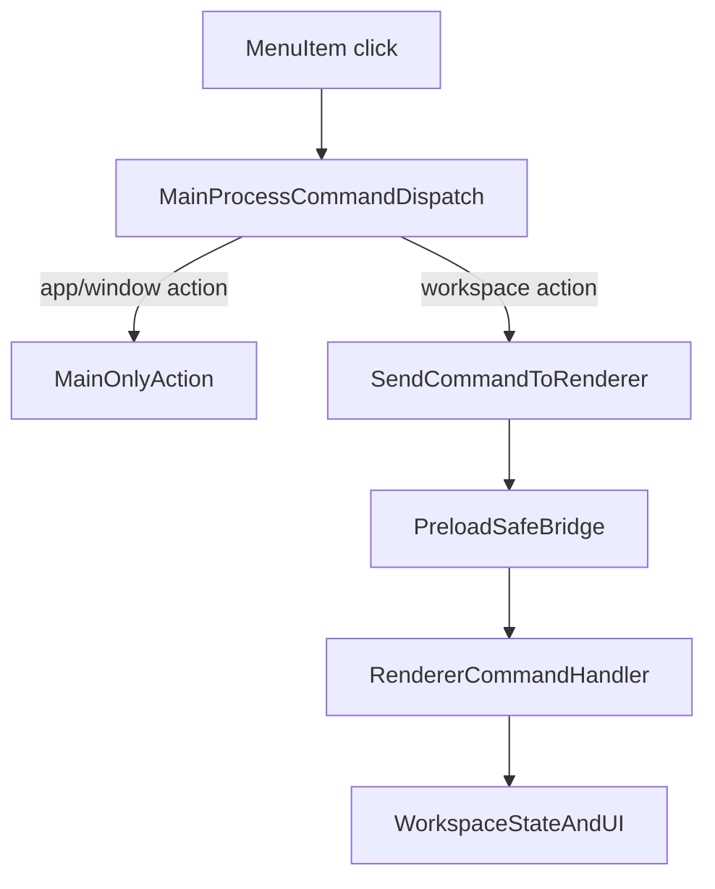

# Brick-Motion Full Menu Integration Plan

## Objective
Replace Electron’s default app menu with a fully custom, cross-platform Brick-Motion menu that is consistent with the app workflow, keyboard bindings, and security posture.

## Target Files
- [electron/main.ts](electron/main.ts): define and register `Menu` template, platform-specific structure, menu action routing
- [electron/preload.ts](electron/preload.ts): expose safe menu-event bridge to renderer
- [src/renderer/types/global.d.ts](src/renderer/types/global.d.ts): add typed menu-event API
- [src/renderer/app/App.ts](src/renderer/app/App.ts): subscribe to menu commands and map to existing actions (capture/play/pause/delete/open/new/export/devtools)
- [docs/technical-brief.md](docs/technical-brief.md): add menu architecture decisions, behavior notes, and keyboard shortcut table (accelerators vs. workspace bindings)

## Menu Architecture
- Build menu once in main process with `Menu.buildFromTemplate()` and `Menu.setApplicationMenu()`.
- Use a command-routing model:
  - `main` emits command IDs (`menu:newProject`, `menu:capture`, etc.)
  - `renderer` handles command IDs through a single dispatcher.
- Keep privileged actions in main (dialogs, app/window ops); keep capture/playback state actions in renderer.

## Proposed Top-Level Menus
- Brick-Motion (app menu on macOS): About, Preferences (future), Quit
- File: New Project, Open Project, Open Recent, Export Sequence, Close Project
- Edit: Undo/Redo/Cut/Copy/Paste/Select All (standard roles)
- Frame: Capture Frame, Delete Frame, Jump to Live
- Playback: Play/Pause, Reset, Toggle Loop, FPS presets (optional submenu)
- View: Toggle DevTools (dev only), Reload (dev only), Toggle Fullscreen
- Window: Minimize/Zoom/Bring All to Front (platform role items)
- Help: Documentation links

## Cross-Platform Rules
- macOS:
  - include application menu and standard role ordering
  - `Cmd`-based accelerators
- Windows/Linux:
  - same functional menus with `Ctrl` accelerators
  - keep menu visible (full custom menu requested)
- Dev-only items (`Reload`, `Force Reload`, `Toggle DevTools`) gated by environment.

## Command Map and Accelerator Alignment
- Match existing workspace keys where practical:
  - Capture: `C`
  - Play/Pause: `Space`
  - Delete Frame: `Delete`
  - Toggle Onion: `O`
  - Prev/Next Frame: Left/Right
- Add standard app accelerators:
  - New Project: `CmdOrCtrl+N`
  - Open Project: `CmdOrCtrl+O`
  - Export Sequence: `CmdOrCtrl+E`
- Resolve collisions by prioritizing text-input focus behavior in renderer.

## Implementation Phases
1. Main menu scaffold
   - Replace default menu with full template and platform branches.
2. Menu command transport
   - Add secure main->preload->renderer command channel.
3. Renderer command dispatcher
   - Map each command ID to existing app actions and state transitions.
4. Role and fallback behavior
   - Ensure commands gracefully no-op when no project/workspace is active.
5. Docs and keyboard alignment
   - Update docs and ensure accelerator/shortcut behavior is explicit.
6. Validation
   - Manual cross-platform checks and command matrix verification.

## Validation Checklist
- Menu appears with custom structure on all platforms.
- Every menu item performs expected action or intentional no-op with feedback.
- Dev-only menu items are hidden in production build.
- macOS conventions (app menu/window roles) are respected.
- Keyboard accelerators do not break existing capture/timeline input rules.