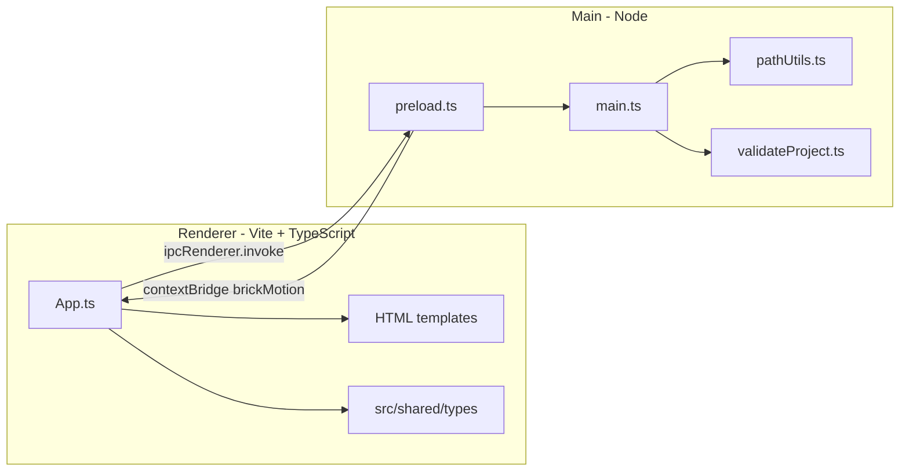

# Brick-Motion technical brief

Single developer-facing overview: product behavior, architecture, security, on-disk format, keyboard shortcuts, camera UI, persistence, and roadmap notes.

---

## Product goal

Brick-Motion is a **local-first** stop-motion app: live capture from the system camera, a scrubbable timeline, predictable files under a chosen project folder, and export of editor-friendly image sequences. No network or accounts; all state lives on disk next to the project.

## Branding and ownership

- **App name:** Brick-Motion
- **Author:** Jonan Steiner
- **Contact:** `jonan.steiner@gmail.com`
- **Website:** `https://jonan.space`
- **Brand asset:** `public/assets/logo.jpg` is used as the renderer favicon and as the Electron window icon when available.

## Core user flow

1. **Start screen** — create a project or open a folder that already contains `project.json`.
2. **New project** — title, capture mode (**JPEG source + preview** vs **PNG source + JPEG preview**), FPS (1–60), and project root directory.
3. **Capture workspace** — live preview, timeline with thumbnails, playback, onion skin, and custom right-side panels (Sequences, Project Settings, Export, Camera Controls, Help). Header actions open these panels; they do not mutate global `body` layout.
4. **Export** — export source frames for the **active sequence** (default), a **selected set of sequences**, or **all sequences**. Output can target **Project Exports** or a **Custom Folder**. Multi-sequence export writes one subfolder per sequence using `<slug(title)>-<shortId>`.

## Primary UI surfaces

| Surface | Notes |
| --- | --- |
| Start | Start screen contains primary create/open actions only. |
| New project form | `src/renderer/templates/new-project/newProjectForm.ts` |
| Capture workspace shell | `src/renderer/templates/capture-workspace/shell.ts` — header, video area, toolbar, timeline slot, and custom sidepanel markup. |

## UI specification baseline (current)

The renderer UI follows a Bootstrap-first system with shared app tokens and limited custom `bm-*` primitives.

### Design tokens and typography

- Sass theme variables are defined in `src/renderer/styles/main.scss` before Bootstrap import (`$primary`, `$secondary`, `$border-color`, radius/input variables).
- App-level CSS custom properties define consistent scales (`--bm-font-xs/sm/md`, `--bm-radius-*`, `--bm-space-*`, `--bm-motion-fast`, `--bm-meta-color`).
- Shared title hierarchy:
  - `bm-panel-title` for major page titles (start/new project).
  - `bm-workspace-title` for capture workspace header title.
  - `bm-section-title` for section/subpanel headings.
  - `bm-panel-subtitle` and `.text-secondary` for tertiary/meta text.

### Interaction and button system

- Shared button motion and focus behavior is centralized in `main.scss` (`.btn` transition + `:focus-visible` ring).
- Variant behavior is intentionally black/yellow themed:
  - `btn-primary` and active states
  - `btn-outline-secondary` and `btn-outline-primary`
  - icon-only controls via `bm-icon-control` (uniform square target)
- Toolbar and timeline controls use the same hover/active/focus rhythm as panels and start screen.

### Panels and layout primitives

- Workspace right-side menus use `aside.bm-sidepanel` (custom drawer), not Bootstrap offcanvas.
- Core app shells are custom primitives:
  - `bm-workspace`, `bm-main-area`, `bm-live-container`, `bm-live-preview`, `bm-timeline`.
- Sequence manager cards are fixed 16:9 tiles with overlayed title/meta and inline actions.
- Help panel uses minimal table layout (`bm-help-shortcuts`) with divider-separated sections.

### Responsive behavior

- Sidepanel width adapts by breakpoint:
  - desktop: `min(34vw, 540px)`
  - medium: `min(45vw, 520px)`
  - small: `100vw`
- Tablet/mobile normalization includes:
  - tighter toolbar wrapping and spacing
  - smaller timeline thumb/live column widths
  - reduced control/button sizes
  - compact start/new-project panel and title scaling

---

## Architecture (high level)



- **Renderer** has no Node integration. It talks to the system only via the **preload**-exposed `window.brickMotion` API (typed in `src/renderer/types/global.d.ts`).
- **`src/renderer/templates/`** holds **markup-only** string builders per screen. **`src/renderer/app/<route>/`** holds **runtime behavior** for that route (listeners, IPC); the capture route uses **`src/renderer/app/capture-workspace/`** alongside **`src/renderer/templates/capture-workspace/`** (shell markup).
- **Main process** owns the filesystem, dialogs, and validation. Shared **types and project validation** live under `src/shared/` and are compiled into the Electron bundle via `tsconfig.electron.json`.

---

## Repository layout

| Path | Role |
| --- | --- |
| `electron/main.ts` | Window lifecycle and IPC registration/composition |
| `electron/menuCommands.ts` | App menu template + typed `menu:command` bridge dispatch |
| `electron/recentProjects.ts` | Recent-project persistence/listing service used by main handlers |
| `electron/preload.ts` | `contextBridge.exposeInMainWorld("brickMotion", api)` — narrow, typed surface |
| `electron/camera/` | `CameraService`, `MediaFoundationBackend`, `loadCameraMfAddon` — camera IPC only (no WebRTC in renderer) |
| `native/camera-mf/` | `node-gyp` N-API addon: MF device enum/open, source reader preview, WIC JPEG/PNG stills, dedicated camera thread |
| `electron/pathUtils.ts` | `resolveSafePathInsideProject` — prevents `..` path escape from project root |
| `src/shared/types/project.ts` | `ProjectFile`, `FrameRecord`, `ProjectSession`, `CaptureMode` |
| `src/shared/validateProject.ts` | `parseAndValidateProject`, `validateCreateProjectPayload` — used on create, open, save |
| `src/renderer/main.ts` | Renderer entry (mounts app root) |
| `src/renderer/app/App.ts` | Top-level route state and composition of workspace controllers/helpers |
| `src/renderer/app/menuDispatch.ts` | Renderer handling for top-level app menu command events |
| `src/renderer/app/projectImages.ts` | Blob URL image cache + `readFileBuffer` image loader for workspace surfaces |
| `src/renderer/app/routeBindings.ts` | Start/new-project route binding helpers |
| `src/renderer/app/routeRender.ts` | Start/new/workspace route render helpers and pending panel reopen |
| `src/renderer/app/cameraControls.ts` | Capability-driven sliders; IPC to main for get/set controls (native backend) |
| `src/renderer/app/userFeedback.ts` | `setUserNotifier`, `reportError`, `reportInfo` — workspace status line |
| `src/renderer/utils/htmlEscape.ts` | `escapeHtml` for user- or device-derived strings in templates |
| `src/renderer/templates/*` | HTML string builders per screen (no IPC; no imports from `App.ts`) |
| `src/renderer/app/capture-workspace/*` | Capture workspace controllers (timeline, camera, shortcuts, panels, etc.) |
| `dist-renderer/` | Vite production output (`npm run build:renderer`) |
| `dist-electron/` | Compiled main + preload + shared TS (`npm run build:electron`) |

`package.json` sets `"main": "dist-electron/electron/main.js"` so production loads the built main process next to `dist-electron/electron/preload.js`.

Startup polish: the renderer `index.html` includes an immediate, branded boot splash so users do not see a plain white screen before the start screen is mounted. The boot splash image is chosen once per launch in `public/boot-splash.js` and persisted in `sessionStorage` (`brick-motion.splash-image`) so the start screen background matches the same image.

---

## Build and run

| Script | What it does |
| --- | --- |
| `npm run dev` | Concurrently: Vite dev server + Electron loading `ELECTRON_START_URL` (see `package.json`) |
| `npm run build` | `vite build` then `tsc -p tsconfig.electron.json` |
| `npm run start` | Run Electron against built assets (run `npm run build` first) |
| `npm run dist` | Build and package installables with electron-builder (output under `release/`) |
| `npm run dist:win` | Build and package Windows NSIS installer (`release/Brick-Motion-Setup-<version>.exe`) |

**TypeScript:** renderer uses the Vite/tsconfig setup; Electron uses **CommonJS** output with `rootDir: "."` so `electron/` and `src/shared/` compile together into `dist-electron/`.

**Packaging:** installables are built with **electron-builder** using the `build` field in `package.json`. Windows packaging currently disables auto-sign discovery (`CSC_IDENTITY_AUTO_DISCOVERY=false`) and executable editing so local unsigned builds work without elevated symlink permissions. The Media Foundation native addon is bundled as an extra resource under `resources/native/camera-mf/build/Release/camera_mf.node`.

**Native addon (Windows, Media Foundation):** building `camera_mf.node` requires **node-gyp**, **Python** (node-gyp prerequisite), **Visual Studio Build Tools** (MSVC) with C++ workload, and the **Windows SDK**. After installing dependencies, run `npm run rebuild:native` so the binary matches Electron’s Node ABI (or `npm run build:native` for plain Node, then prefer `rebuild:native` for the app). Without a built addon, the app still runs but lists no cameras until the native layer is built.

If **`npm run build:native`** logs **`unknown version "undefined" found at "...\Microsoft Visual Studio\18\..."`**, you have **Visual Studio 2025+** (installer major version 18). **node-gyp 11** does not recognize it; this repo pins **node-gyp ^12** so `npm install` picks a release that treats VS 18 as supported. If you still see that message after `npm install`, ensure you are not invoking an older global `node-gyp`.

If **`npm run build:native`** still fails with **`EPERM: operation not permitted, rmdir '...\native\camera-mf\build'`** (or similar), something is locking files under **`native/camera-mf/build`**—often **`npm run dev` / Electron**, **OneDrive**, or **antivirus**. **`npm run build:native`** runs **`scripts/native-build.cjs`**, which removes `build` using **`fs.rmSync` with retries** and then **`node-gyp configure build`** (it does **not** use **`node-gyp rebuild`**, so you avoid node-gyp’s separate clean step that often hits the same lock). Quit the dev session and retry; use **`npm run build:native:incremental`** for a quick compile **without** deleting `build` first. For the stock **`node-gyp rebuild`** behavior (two clean passes), use **`npm run build:native:gyp-rebuild`**.

If **`npm run dev`** / Vite fails with **`EPERM ... rmdir '...\node_modules\.vite\deps'`**, the same lock/sync issues apply. **`vite.config.mts`** sets **`cacheDir`** to **`%TEMP%\brick-motion-vite`** so dependency pre-bundling does not rewrite under **`node_modules/.vite`**. Close other tools using that tree, then retry; you can delete the temp cache folder if it looks corrupted.

---

## Security and IPC

- **`contextIsolation: true`**, **`nodeIntegration: false`**, **`sandbox: true`** on `BrowserWindow` — renderer is isolated; only the preload runs in a privileged bridge context.
- **Small preload API** — no blanket `ipcRenderer.invoke(channel, …)`; each operation is a named method on `brickMotion`.
- **Validation in main** — `project.json` is validated on open and save; create-project payload is validated before writing.
- **Path confinement** — frame delete, data-URL reads, and export copy paths use `resolveSafePathInsideProject` so relative paths cannot walk above `projectRoot`.
- **Renderer XSS hygiene** — templates use `escapeHtml` where needed; recent-project buttons store paths as `encodeURIComponent` in attributes and decode on click (with fallback for legacy rows).
- **Menu command bridge** — Electron app menu clicks route through main (`Menu` template) and send typed command events over `menu:command` to preload/renderer. Privileged app/window operations remain in main; workspace actions dispatch in renderer.

If sandboxed preload misbehaves on an Electron upgrade, toggling `sandbox` is a localized change in `createMainWindow`; do not disable `contextIsolation`.

---

## Keyboard shortcuts (capture workspace)

| Key | Action |
| --- | --- |
| `ArrowLeft` | Previous frame / step toward earlier thumbnail |
| `ArrowRight` | Next frame / toward live |
| `Home` | First timeline frame (or Live if empty); stops playback |
| `End` | Last captured frame; stops playback |
| `Space` | Play / pause forward from current position |
| `J` | Shuttle reverse (play backward; `K` to stop) |
| `K` | Stop playback (pause) |
| `L` | Shuttle forward (same as starting playback forward) |
| `O` | Toggle onion skin |
| `C` | Capture frame (unmodified `C` only; same as the capture button) |
| `Ctrl+A` / `⌘A` | Select all timeline frames |
| `Ctrl+D` / `⌘D` | Duplicate current frame or selected timeline frames |
| `Delete` | Delete current frame (or last frame when on live view) |
| `Backspace` | Same as delete |
| `Ctrl+Z` / `⌘Z` | Undo latest frame action from the app history (capture/undo-capture, single or multi delete/restore, duplicate/undo-duplicate). |
| `Ctrl+Shift+Z` / `⌘Shift+Z` | Redo latest frame action from the app history when available. |
| `Escape` | Exit fullscreen first (when active). If not fullscreen, clear multi-selected timeline frames. |

**Timeline:** frame thumbnails and timecodes scroll horizontally on the left; the **Live** button stays fixed on the **right** (same row as the thumbnails) so it stays visible while scrubbing. The visible horizontal scrollbar appears under the timecode row (single visible scrollbar), and the full timeline strip supports drag-to-pan. With **no frames** yet, a non-interactive **#0** outline placeholder appears in the scroll area until the first capture. Thumbnails keep a **fixed width** (they do not shrink as more frames are added). With the playhead on **Live**, the scroll position moves to the **end** so the newest frames sit beside Live; with the playhead on a frame, that frame is kept in the visible range when possible. **Ctrl+click** (Windows/Linux) or **⌘+click** (macOS) toggles frames in a multi-selection; **Shift+click** selects a contiguous range from the last anchor; **Ctrl+A** / **⌘A** selects all frames. **Ctrl+D** / **⌘D** duplicates the current frame or all selected frames as a contiguous block inserted after the last source frame. **Delete** / toolbar trash removes **all** selected frames when more than one is selected.

**Scope:** shortcuts are inactive while **inputs**, **textareas**, or **contenteditable** elements are focused. Empty timeline actions are effectively no-ops; status text may reflect that.

### App menu integration

- The app uses a custom cross-platform menu template defined in `electron/menuCommands.ts` and installed from `electron/main.ts` (`Menu.setApplicationMenu(...)`).
- Top-level groups: **Project**, **Sequence**, **Frame**, **Playback**, **View** (plus the macOS app menu and macOS window menu roles).
- **View** dev tools entries (`Reload`, `Force Reload`, `Toggle DevTools`) are available only in development mode.
- File-level commands (`New`, `Open`, `Project Settings`, `Export`, `Back to Home`) are routed as typed menu commands; workspace commands no-op when the workspace route is inactive.
- **Frame** includes app-level **Undo** / **Redo** (`CmdOrCtrl+Z` / `CmdOrCtrl+Shift+Z`) scoped to frame actions (capture/undo-capture, single or multi delete/restore, duplicate/undo-duplicate).
- On non-macOS platforms, the menu bar is hidden by default at window creation and is toggled by route (`workspace` = visible, `start` = hidden), so it is not shown on the startup splash/start screen.
- Renderer history is implemented as a command stack (`apply`/`revert`) with bounded undo/redo depth. Commands carry a context object with `projectRoot` and a reserved optional `sequenceId` field so upcoming multi-sequence history can be scoped without replacing the history core.

---

## Camera (native pipeline)

The renderer does **not** use `getUserMedia` or `MediaStreamTrack`. The main process owns **`CameraService`** and **`MediaFoundationBackend`** (loading `native/camera-mf/build/Release/camera_mf.node`). The renderer calls **`brickMotion.camera*`** through preload.

**Versioning:** See [VERSIONING.md](./VERSIONING.md). The current stable release is **1.0.0** (`package.json`). Users see **Version 1.0.0** on splash, window title, and Help → About. **`appVersion`** in `project.json` is only the project file schema.

**Live preview:** **`camera:open`** binds the invoking **`BrowserWindow`** as the preview target (listing devices does **not**). Preview/capture JPEG long-edge limits are fixed in shared constants (`src/shared/previewJpeg.ts`, currently 960) and applied in the native MF layer. The MF addon async-pumps MJPEG samples, downscales on a worker thread to the live cap, and the main process polls preview JPEGs (fast follow when frames advance). Each frame is **`webContents.send("camera:preview", Uint8Array)`** (JPEG bytes via structured clone). Preload **`cameraPreviewSubscribe`** passes **`Uint8Array`** through to the app without an extra copy. The workspace sets an **``** from a short-lived **blob URL** and revokes the previous URL after load/error.

At open, the MF addon negotiates the **largest MJPEG** mode for the whole session (live preview and capture share one stream; see `native/camera-mf/CAMERA_CAPTURE.md`). Terminal logs list top MJPEG modes. Live and on-disk **preview** JPEGs are capped via WIC downscale; **`frames/source-jpeg`** stores the native MJPEG capture bytes; **`source-png`** decodes that JPEG to PNG when capture mode is PNG.

**Timeline strip files:** On each capture, main process writes **`frames/timeline-thumb/`** JPEGs (max long edge **`TIMELINE_THUMB_MAX_LONG_EDGE_PX`** in [`src/shared/timelineThumb.ts`](../src/shared/timelineThumb.ts), aligned with **~140px-wide** `.bm-thumb` cells in CSS). Every `FrameRecord` includes required **`timelineThumbPath`**; reconciliation drops frames missing preview, source, or thumb on disk.

### Discovery and controls

- **`camera:list-devices`** returns `{ id, label }[]` from the MF native addon (USB webcams today; DSLR tether reserved).
- **`camera:get-capabilities`** / **`camera:get-controls`** / **`camera:set-controls`** drive the panel built by **`renderCameraControlsInner`**; capabilities are a JSON-friendly map (min/max/step per key when applicable).
- **`camera:capture-live`** writes frames via **`writeCapturedFrameBuffers`** in main (same atomic temp/rename rules as duplicate capture via **`frame:capture`** with data URLs).

### Range sliders (numeric)

**`rangeControls`** in code include `focusDistance`, `zoom`, `colorTemperature`, exposure-related keys, `brightness`, `contrast`, `saturation`, `sharpness`, plus dynamic keys from capabilities. UI groups match the previous Focus / White balance / Exposure layout; **`zoomSliderMax`** still caps the zoom slider when needed.

### Persistence

- Values persist under **`cameraProfile.values`**; **`supportedControls`** stores the last capability snapshot from the backend.

### USB Media Foundation notes

- **`iso`** and **`sensitivity`** are **aliases** for **`gain`** (`VideoProcAmp_Gain`) when the driver exposes manual gain — not a separate sensor ISO control.
- **`exposureCompensation`** maps to **backlight compensation** on the video proc amp when the driver exposes manual control.
- **Pan/tilt** only appear if **`IAMCameraControl`** reports manual ranges (often only in certain zoom regimes).
- **Preview/capture format:** MJPEG only at open; devices without MJPEG fail with `no_mjpeg_mode`.

### Not implemented yet

- **DSLR backend** — `CameraBackend` seam is ready for a future tether adapter.

---

## Data integrity (runtime)

- Deleting a frame removes preview and source files under the project (and optional thumb path when used).
- Frame identity is an immutable **`frameId`**; ordering is `frameIdOrder`.
- Export copies **source** files into either `exports/sequence` (project mode) or the selected custom folder, with sequential names based on a user-configurable prefix (default `frame_`).
- Conflict handling is explicit and preselected in the export panel: **Replace Existing** (clear target first) or **Create New Folder** (auto-suffixed folder).
- Changing the project folder uses a whole-project move (project file + frames + exports + cache) so relative frame paths remain valid under the new root.

---

## Persistence, reliability, and recovery

### Atomic writes

- New frames: write `.tmp` files, then rename to final names in `frames/`.
- **`project.json`**: write to a unique temp file in the same directory, then rename, with retry and Windows-friendly copy fallback (see `electron/main.ts`).

### Autosave

- The renderer calls **`saveProject`** after capture, delete, undo, project settings changes, and camera profile updates.
- **Current behavior:** saves are **immediate** per action (no debounce). Optional future: debounce rapid setting tweaks.

### Validation and recovery

- **Implemented:** `parseAndValidateProject` on open and save — malformed projects are rejected with an error instead of partial load.
- **Implemented:** project folder change performs a whole-directory move and rewrites `project.json` at the new root so the session continues with one canonical project location.
- **Roadmap:** on open, optionally verify `framesById` paths against files on disk and warn or auto-heal safe mismatches.

### Camera reconnect

- Timeline and project state stay in memory if the camera drops; user can refresh devices or pick another from the dropdown without reloading the project. Persisted settings are reapplied **best effort** after a new stream is acquired.

---

## Project file and disk layout

`project.json` is the single source of truth. Types and validation live in `src/shared/` and are used by the main process.
`sourcePath` is persisted as the current project root path and is updated when the project folder is relocated.
Legacy single-sequence project files are not supported.

### Schema (reference)

```json
{
  "appVersion": 1,
  "projectTitle": "Sample",
  "captureMode": "jpeg_only",
  "fps": 12,
  "sourcePath": "C:/Projects/Sample",
  "frameIdOrder": [],
  "sequenceOrder": ["sequence_1"],
  "sequencesById": {
    "sequence_1": {
      "id": "sequence_1",
      "title": "Sequence 1",
      "frameIdOrder": [],
      "createdAt": "2026-01-01T00:00:00.000Z",
      "updatedAt": "2026-01-01T00:00:00.000Z"
    }
  },
  "activeSequenceId": "sequence_1",
  "framesById": {},
  "cameraProfile": {
    "backend": "usb_webcam",
    "deviceId": null,
    "zoomSliderMax": null,
    "supportedControls": {},
    "values": {}
  },
  "uiState": {
    "onionEnabled": false,
    "onionOpacity": 0.45,
    "loopEnabled": false,
    "timelinePosition": "live",
    "playbackTimingMode": "hold_after_decode",
    "showPlaybackFpsOverlay": false
  },
  "createdAt": "2026-01-01T00:00:00.000Z",
  "updatedAt": "2026-01-01T00:00:00.000Z"
}
```

### `cameraProfile` fields

- **`deviceLabel`**: optional display name for the selected camera.
- **`deviceId`**: opaque MF symbolic-link id for the USB webcam, or `null`.
- **`zoomSliderMax`**: optional number or `null` — caps the zoom slider when the reported range is wrong.
- **`supportedControls`** / **`values`**: snapshots used for UI and persistence (capabilities + control map).

### Frame metadata (`framesById` values)

- **`sequenceIndex`**: index in timeline order.
- **`previewPath`**, **`sourcePath`**: project-relative POSIX paths.
- **`timelineThumbPath`**: small JPEG for the timeline strip (`frames/timeline-thumb/`). If omitted in JSON, validation infers `frames/timeline-thumb/<same basename as preview>`; **`project:open`** reconciliation creates that file from the preview JPEG when missing (then saves `project.json` if anything changed).
- **`createdAt`**: ISO timestamp.

### Sequence metadata (`sequencesById` values)

- **`id`**: stable sequence identifier.
- **`title`**: user-visible sequence name.
- **`frameIdOrder`**: ordered frame ids for that sequence.
- **`createdAt`** / **`updatedAt`**: ISO timestamps.

### Project directory layout

- `frames/preview-jpeg/`
- `frames/timeline-thumb/`
- `frames/source-jpeg/`
- `frames/source-png/`
- `exports/`
- `cache/thumbs/`

### File naming

- Capture files: `frame_<six-digit-seq>_<frameId>.<ext>` under the appropriate `frames/...` folder (UUID in the filename).
- Export copies: `<prefix><six-digit-seq>.<ext>` (default `frame_000001.jpg` / `.png`) inside the chosen export target.

**Recent documents:** Electron `app.addRecentDocument(projectFilePath)`; the start screen lists recent paths ending in `project.json`.

---

## Renderer conventions

1. **Feature modules** return HTML strings; **`App.ts`** owns DOM queries, listeners, and async orchestration.
2. **Errors** from IPC or image loads use **`reportError`** after **`setUserNotifier`** wires the workspace status line.
3. **Camera** panel content is built by **`renderCameraControlsInner`**; IPC calls **`camera:get-*`** / **`camera:set-controls`** on the main process backend.

---

## Performance and future work

**Playback timing:** Default mode **`hold_after_decode`**: each frame is shown for `1000 / project.fps` ms (float) **after** load + `decode()` + **two `requestAnimationFrame` ticks** (closer to first paint). Optional **`wall_clock`** mode (forward playback only) aligns waits to `performance.now()` from play start and **may skip** frames if decoding falls behind. **`showPlaybackFpsOverlay`** shows average cycle time, target ms/frame, and skip count during play. A cancel generation counter drops in-flight steps when stopping. While playing, only the playhead highlight and timecode row update; timeline scroll auto-pans **only if** the active thumb leaves the visible strip. Neighbor frames are preloaded.

**Images:** Duplicate/export still use **data URLs** where needed; the workspace **viewer**, onion skin, and **playback** use **`previewPath`** via **`readFileBuffer`** + **blob URLs**. **Timeline** cells load **`timelineThumbPath`** only (same IPC), with **lazy** loads via **`IntersectionObserver`** (**`root`** = `#timelineScrollTrack`) and a small **concurrency limit** so hundreds of frames do not spike IPC/decode at once. Blobs are revoked on frame delete and when leaving the workspace.

**Camera saves:** Control slider changes **debounce** `saveProject` (~450 ms); device selection / camera start still persist immediately.

**When scaling up:**

- Further timeline virtualization (fewer DOM nodes) if frame counts grow very large.
**Historical MVP phases (all core phases delivered):** foundation → project lifecycle → workspace shell → timeline/playback → capture/delete/undo → reliability/autosave → export sequences. Further ideas: formal frame-vs-disk reconciliation on open.

---

## Non-goals (early product)

- DSLR tethering / RAW ingest through this UI.
- Per-frame compositing or drawing tools.
- Cloud sync or multi-user editing.

---

## See also

- **[coding-practices.md](./coding-practices.md)** — conventions for making changes in this repo (scope, TypeScript, Electron, renderer, security, docs).
